# Data Visualization & UI Design Portfolio

Design case studies from my **Advanced Visualization & Storytelling** coursework (UE24CS342AA9) at PES University.
Each one starts from a real user complaint — a manager, a director or a policy team who was misled or slowed down
by a chart — and shows the design decisions I made to fix it.

**Aadish Sarin** · B.Tech CSE, PES University (2028) · [GitHub](https://github.com/aadishs-364) · [LinkedIn](https://www.linkedin.com/in/aadish-sarin/)

---

## 0. Product UX: letting visitors see value before signing in
**Users:** PES students checking placement stats for the first time.
**Problem:** every page sat behind a login, so first-time visitors met a sign-in form before seeing anything worth signing in for.
**Figma file:** [Placement Tracker — First-visit flow](https://www.figma.com/design/DQlgbODIUkb2ULjPSAE4AX/Placement-Tracker-%E2%80%94-First-visit-flow?node-id=0-1&t=M95Q0SL1f33KmCE6-1)

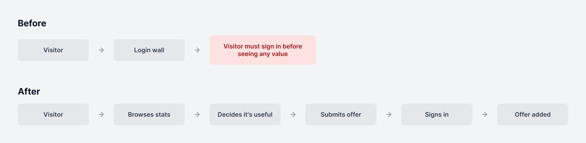

| Before: login wall | After: browse first |
|---|---|
| 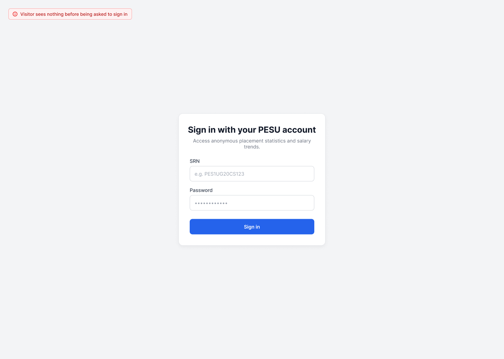 | 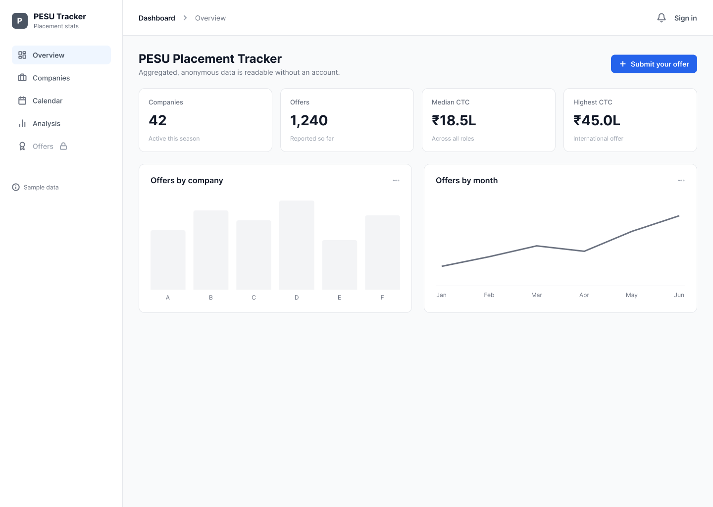 |

| Sign-in asked only when needed | Login card on the real theme tokens |
|---|---|
| 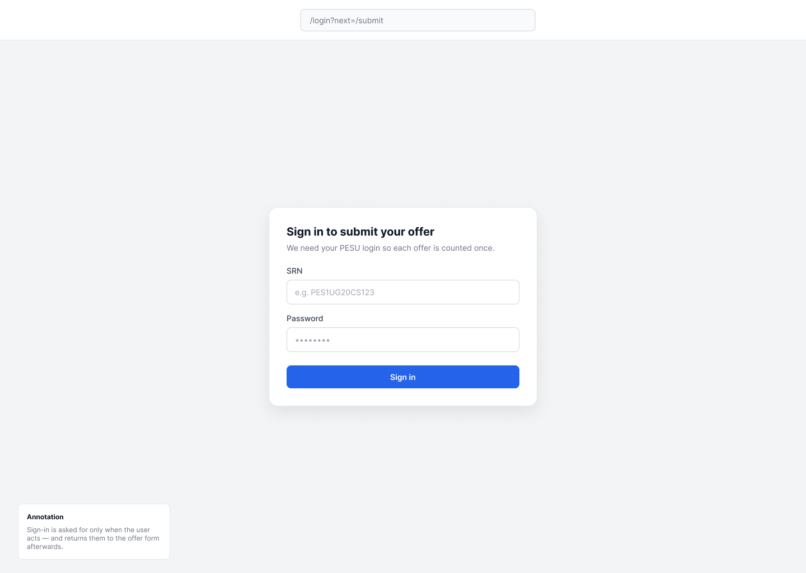 | 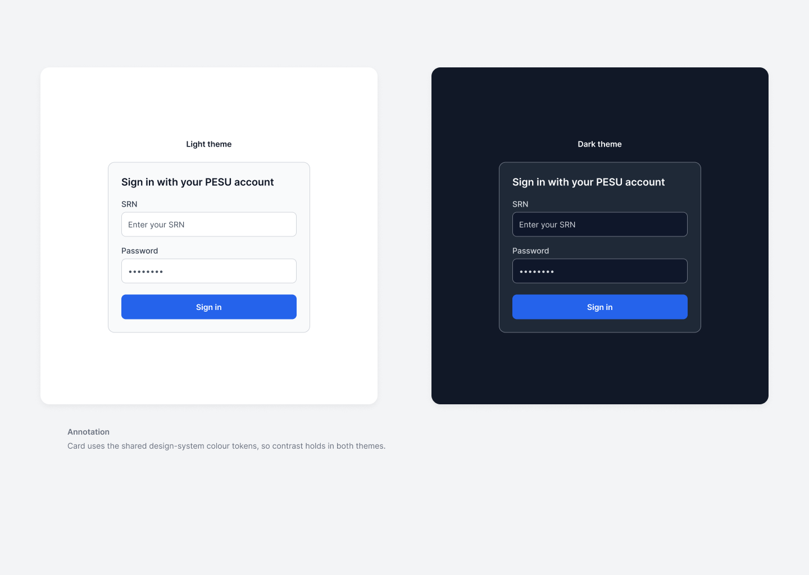 |

**Design decisions**
- Aggregated data is already anonymous, so reading it no longer requires an account; only submitting or viewing personal records does.
- The login card used colour tokens that didn't exist, so inputs washed out; moving it onto the shared design-system tokens restored contrast in light and dark themes.
- Signing in to submit sends you to the login page and back to the offer form afterwards (next=/submit), so the action isn't lost.
- Shipped as merged pull requests: [see the PRs](https://github.com/Audatic07/pesu-placement-tracker/pulls?q=is%3Apr+author%3Aaadishs-364+is%3Amerged)

## 1. Pre-publish ethics review
**Users:** a regional manager about to send a performance report to the whole company.
**Problems she raised:** no clear reading order, a chart that breaks on a grayscale printer, an axis that turns a
small change into a crisis, and an annotation that claims more than the data shows.

| Visual hierarchy | Accessible colour + pattern |
|---|---|
| 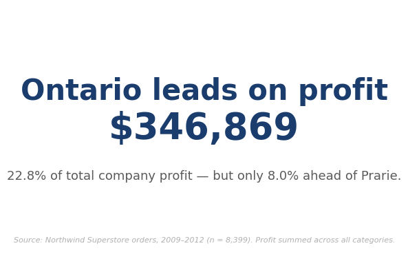 | 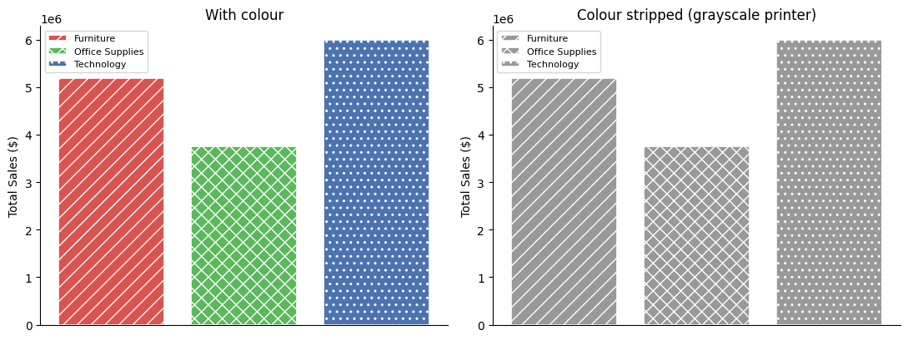 |

| Honest vs truncated axis | Rewriting an overreaching annotation |
|---|---|
| 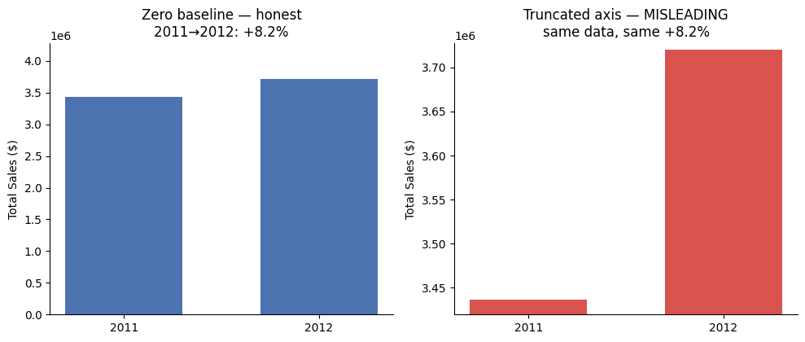 | 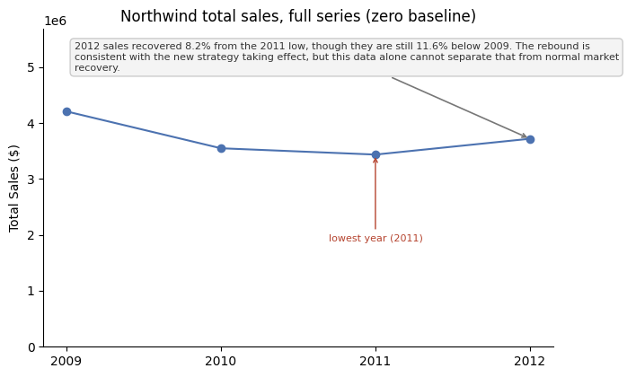 |

**Design decisions**
- **Reading order on purpose:** size, weight and colour stacked so the eye lands on the key number first, the takeaway second and the source last.
- **Never colour alone:** the draft used red against green, the pairing hardest for the ~8% of men with red-green colour blindness. Each bar now also has its own hatch pattern, so the chart survives colour blindness *and* a grayscale printer.
- **Honest baselines:** the same +8.2% change shown on a zero baseline and on a truncated axis, side by side, so reviewers can see how much the axis was doing the storytelling.
- **Words that match the evidence:** "This PROVES our strategy is working" rewritten into a descriptive and a hedged interpretive version, with a note on the evidence the causal claim would actually need.

## 2. Interactive dashboard for regional managers
**Users:** regional managers who got a static monthly PDF and had to email the analytics team for every follow-up.

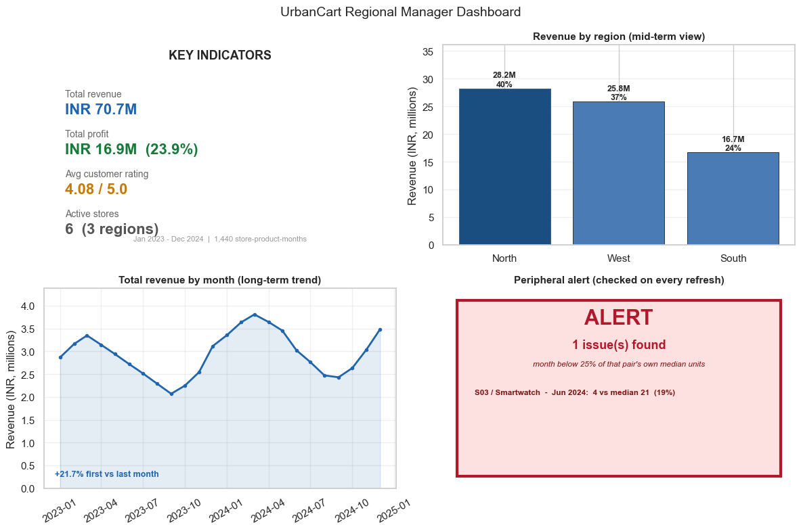

| Coordinated views (overview + detail) | Focus + context drill-down |
|---|---|
| 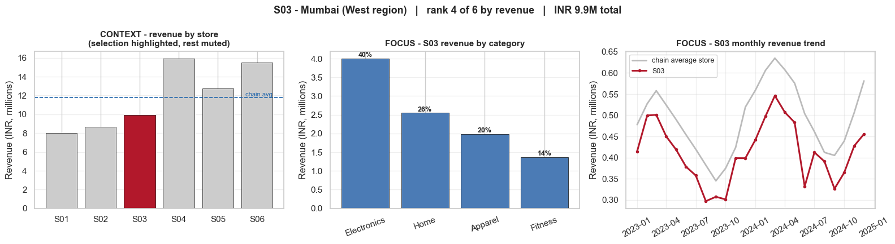 | 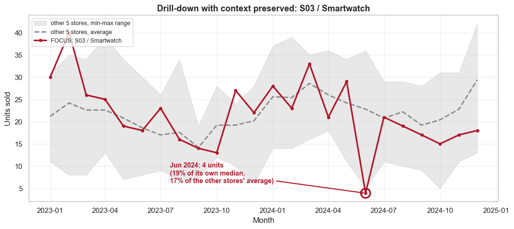 |

**Design decisions**
- **Static for the headline, interactive for the follow-up:** hover answers "exactly how much is this bar?" without a printed axis.
- **Range sliders** so managers can filter by price and units themselves, sized for the data (1,440 rows today; I noted where a 50x bigger dataset would need a different technique).
- **Coordinated views:** the store overview stays on screen as context while the selected store's breakdown updates as focus.
- **Cheapest interaction first:** the planted sales dip is spotted by eye on the overview, then investigated with hover, without opening a new screen.
- **One glanceable screen:** KPIs, trend, regional split and a high-contrast alert panel for the one issue that needs action.

## 3. Colour theory for a policy briefing
**Users:** a policy think-tank reading well-being trends from the World Happiness Report.

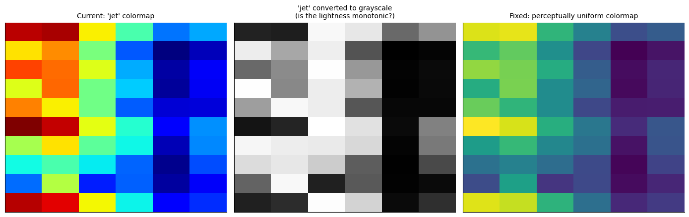

| Diverging scale around the global mean | Accent colour for the two countries that matter |
|---|---|
| 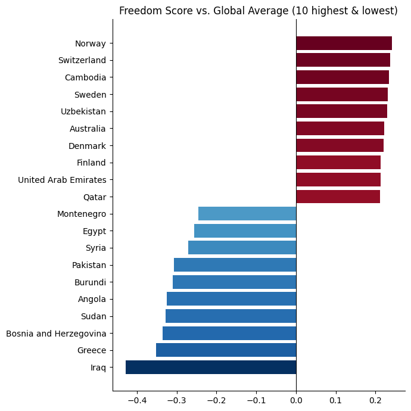 | 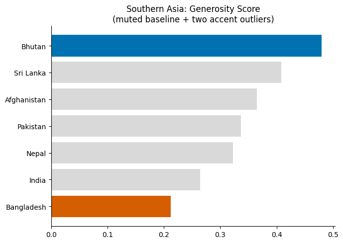 |

**Design decisions**
- **Kill the rainbow:** converting `jet` to grayscale shows its lightness jumps up and down, so it invents patterns. A perceptually uniform colormap fixes that.
- **Diverging scale centred on zero:** above-average and below-average countries read as two colour families meeting at a neutral midpoint.
- **Accent, not decoration:** everything is muted to gray except the highest and lowest country, because those two are the story.

## 4. Global development monitor
**Users:** an NGO director briefing policymakers, previously burned by a misleading map.

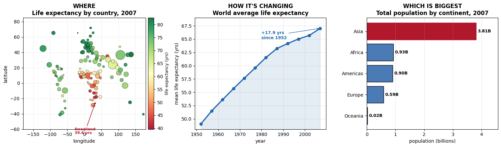

| Explaining one prediction | Showing uncertainty |
|---|---|
| 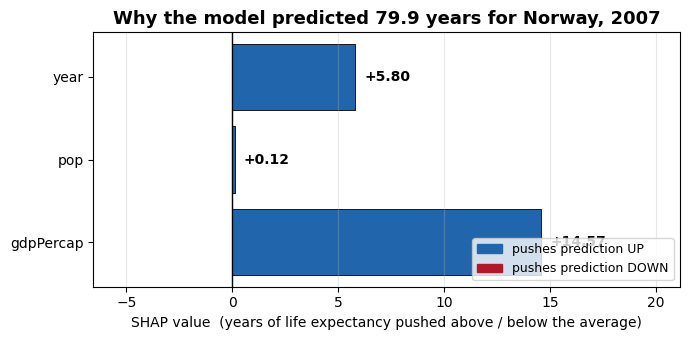 | 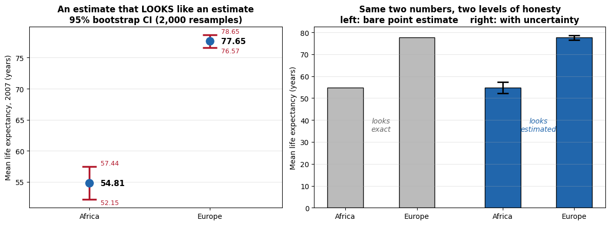 |

**Design decisions**
- **Rates, not counts, on maps:** the total-GDP and GDP-per-capita top-5 lists share only one country, so a count map would have told the director the wrong story.
- **Local explanations for local questions:** when a journalist asks about one country, show that prediction broken into per-feature contributions, not global importance.
- **Estimates must look like estimates:** bootstrap intervals show Africa's average life expectancy is *less* certain than Europe's despite the larger sample, because countries vary more.

---

## All work
| # | Notebook |
|---|---|
| 1 | [Pre-publish ethics review: hierarchy, accessibility, honest axes and annotations](notebooks/01-pre-publish-ethics-review/activity.ipynb) |
| 2 | [Interactive retail sales dashboard for regional managers](notebooks/02-interactive-retail-dashboard/activity.ipynb) |
| 3 | [Colour theory: sequential, qualitative, diverging and accent scales](notebooks/03-colour-theory-policy-briefing/activity.ipynb) |
| 4 | [Global development monitor: maps, explainability and uncertainty](notebooks/04-global-development-monitor/activity.ipynb) |
| 5 | [High-dimensional data: PCA, t-SNE and UMAP for a screening dashboard](notebooks/05-tumor-screening-dimensionality/activity.ipynb) |
| 6 | [Choosing the right chart for real-estate questions](notebooks/06-chart-choice-sprint/activity.ipynb) |
| 7 | [Associations, correlation, time series and smoothing](notebooks/07-associations-and-trends/activity.ipynb) |
| 8 | [Histograms, density plots and proportions for delivery analytics](notebooks/08-distributions-and-proportions/activity.ipynb) |
| 9 | [Headline bar, trend line and multi-variable charts under time pressure](notebooks/09-visualization-fire-drill/activity.ipynb) |

Every notebook is saved **with its outputs**, so all charts and my written reflections are readable directly on GitHub.

## Tools
Python, pandas, matplotlib, seaborn, Plotly, ipywidgets, scikit-learn, SHAP, Jupyter

## Notes
- The datasets (Superstore sample, World Happiness Report, Gapminder, Melbourne housing, Wisconsin breast cancer and
  others) are not included here; they come from their original public sources. The charts above are the saved outputs.
- This is coursework, shared as a portfolio with the original assignment questions kept in each notebook for context.
